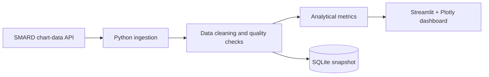

# ⚡ Germany Power Pulse

### [🌐 Open the live interactive dashboard](https://hjsarker.github.io/germany-power-pulse/)

**Live website:** https://hjsarker.github.io/germany-power-pulse/

[](https://hjsarker.github.io/germany-power-pulse/)

**Portfolio links:** [Project overview](https://github.com/hjsarker/germany-power-pulse) · [Dashboard source code](https://github.com/hjsarker/germany-power-pulse/blob/main/app.py) · [Automated test results](https://github.com/hjsarker/germany-power-pulse/actions)

> **Deployment:** GitHub Actions successfully published the static interactive dashboard with official SMARD market data on 24 October 2026. The separate Streamlit app can also be run locally.

**The power behind the price.**

An interactive electricity-market analytics portfolio project using official German generation, demand and day-ahead wholesale-price data from **[Bundesnetzagentur | SMARD.de](https://www.smard.de/en)**.

[](https://python.org) [](https://streamlit.io) [](https://www.smard.de/en)

## What it does

- Retrieves 13 hourly electricity market series from the public SMARD chart-data interface.
- Visualizes historical wholesale prices, negative-price hours, 11 generation technologies, and demand.
- Compares wind/solar generation with wholesale prices using interactive scatter charts.
- Offers a Berlin-local-hour price calendar and CSV export.
- Calculates renewable generation share only for **fully observed** production hours.
- Reports missing observations transparently, without filling gaps with fabricated zeros.
- Includes a reproducible SQLite snapshot option and automated offline unit tests.

## Getting started

Requires Python 3.11 or newer.

```bash
git clone https://github.com/hjsarker/germany-power-pulse.git
cd germany-power-pulse
python -m venv .venv
source .venv/bin/activate
pip install -r requirements.txt
streamlit run app.py
```

Windows virtual environment activation: `.venv\Scripts\activate`.

The first dashboard load fetches hourly market observations from SMARD and caches them for up to one hour. You can select 7, 14 or 30 days. The app displays an error instead of mock readings if the upstream service is unavailable.

Create a local SQLite snapshot with:

```bash
python -m scripts.refresh_data --days 30
```

Run tests:

```bash
pip install -r requirements-dev.txt
python -m pytest -q
```

## System design



| Component | Purpose |
|---|---|
| `app.py` | Interactive dashboard |
| `power_pulse/config.py` | API series mapping and units |
| `power_pulse/smard.py` | HTTP retries, block discovery, hourly normalization |
| `power_pulse/analytics.py` | Descriptive analytics and completeness checks |
| `power_pulse/storage.py` | SQLite upserts and readback |
| `scripts/refresh_data.py` | Local ingestion command |
| `tests/` | Offline unit tests |
| `.github/workflows/tests.yml` | Automated tests |

## Data methodology

**Wholesale electricity prices are not household bills.** Day-ahead prices in EUR/MWh reflect the wholesale market, and the charts should not be interpreted as identifying a single cause of price movements.

SMARD hourly generation quantities are in MWh per hour. The dashboard converts them to GWh for charts. The renewable share is **renewable generation / total observed generation**, calculated only in periods with all 11 generation categories present. It is not a percentage of German electricity consumption. Pumped storage discharge is not treated as a fossil fuel. The 13 series include 11 generation sources, grid load and wholesale day-ahead price.

All API timestamps use UTC. Charts use Europe/Berlin; the autumn daylight-saving repeated hour is merged in heatmap display only. All underlying observations remain separate.

## Availability and limitations

This is an **early portfolio release**, not a production service. Offline unit tests pass locally, but the real SMARD API integration must be smoke-tested in an internet-connected runtime before claiming a public dashboard is fully operational. Source observations can be incomplete or revised, and correlations do not establish causation.

## Public demo

**[Open the interactive Germany Power Pulse dashboard](https://hjsarker.github.io/germany-power-pulse/)**. The free GitHub Pages website uses a scheduled GitHub Actions workflow to fetch official SMARD observations and publish a static data snapshot. The separate Streamlit application can be run locally.

## Source and attribution

Data: **Bundesnetzagentur | [SMARD.de](https://www.smard.de/en)**, made available under **[CC BY 4.0](https://creativecommons.org/licenses/by/4.0/)**. The source records are fetched and reorganized for independent analysis. This dashboard is not endorsed by the data provider. More details: [SMARD data-use policy](https://www.smard.de/home/datennutzung).

Project author: [Hillol Sarker](https://github.com/hjsarker).
